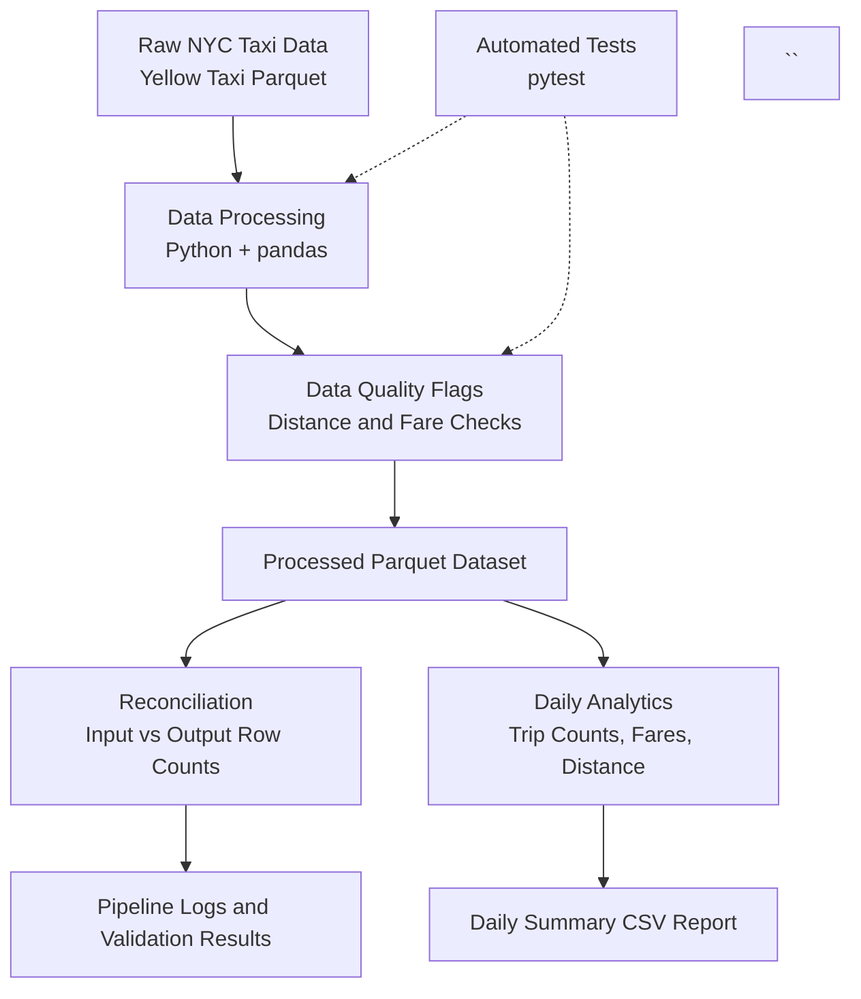

# NYC Taxi Data Engineering Platform — Architecture

## Pipeline Overview

## Components

| Component | Responsibility |
|---|---|
| Raw data | Stores the original NYC Yellow Taxi trip records. |
| Processing | Loads the source data and adds data-quality flags. |
| Data quality | Flags non-positive trip distances and negative fares for review. |
| Reconciliation | Confirms that processing preserves the source record count. |
| Analytics | Calculates daily trip counts, fare totals and averages, average distance, and passenger totals. |
| Reporting | Exports daily metrics to a CSV file. |
| Automated tests | Uses pytest to verify data-quality rules and edge cases. |
| Logging | Records pipeline progress, validation results, and failures. |

## Design Notes

- The raw source file is not modified.
- Suspicious records are flagged for review rather than automatically deleted.
- Record-count reconciliation helps detect unexpected row loss during processing.
- The analytics report includes January 2026 trips based on pickup timestamps.
- Automated tests provide repeatable checks for core data-quality behavior.

